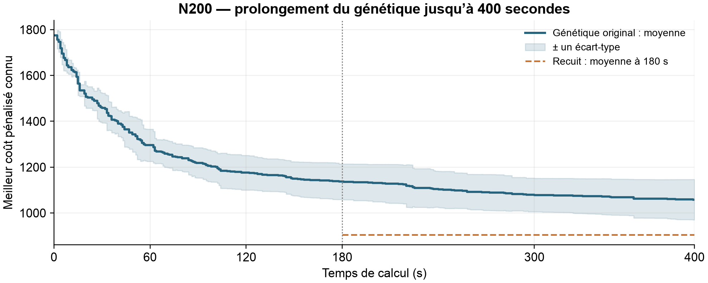
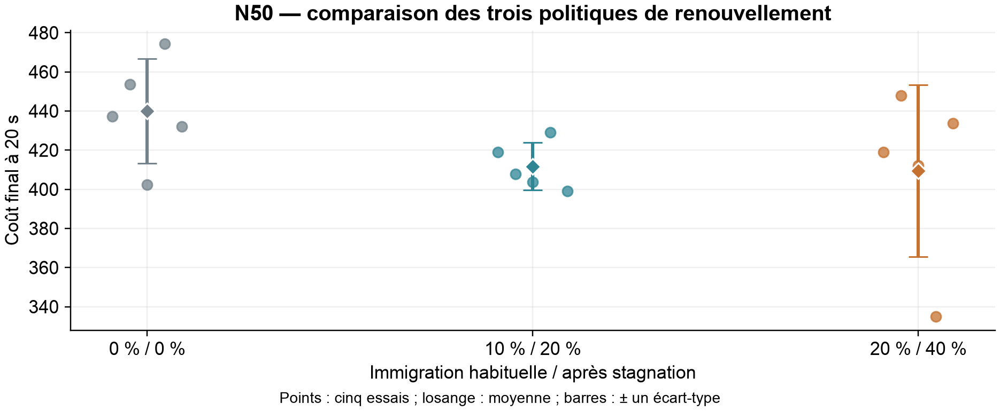

# Nexovia - optimisation de la planification d’interventions

[](https://github.com/axl-chstn/nexovia-optimisation/actions/workflows/verification.yml)

Comment affecter les interventions aux techniciens et organiser leurs tournées, en limitant les déplacements et les reports ? Ce projet d’**Introduction au Génie Industriel**, réalisé à Mines Nancy, compare plusieurs méthodes sur neuf instances, de **N0 (8 interventions) à N200 (200 interventions)**.

Le dépôt rassemble le **notebook complet du groupe**, ses modules Python, les données et les résultats disponibles. Les compléments réalisés après la soutenance sont conservés à part.

## Le problème

Une solution décrit la tournée de chaque technicien et les interventions reportées. Elle doit respecter les compétences, les fenêtres horaires, les disponibilités et le retour au domicile. Chaque intervention apparaît exactement une fois.

Deux lectures du problème sont étudiées :

- **Monoobjectif** : minimiser `f = D + c_report × R`, où `D` est la distance parcourue et `R` le nombre de reports.
- **Multiobjectif** : minimiser séparément `(D, R)` et proposer plusieurs compromis non dominés au décideur.

Les méthodes comprennent un glouton, deux descentes locales, la recherche tabou, le recuit simulé, un algorithme génétique et une proposition hybride ALNS + tabou. La PLS (*Pareto Local Search*) et l’ε-contrainte explorent les compromis distance/reports. Une énumération exacte est fournie pour N0.

## Résultats des compléments au génétique

Cinq graines par configuration. Les coûts ci-dessous proviennent des fichiers enregistrés dans `resultats_apports/` ; ce ne sont pas de nouveaux calculs réalisés pour GitHub.

| N200 — méthode | Budget | Coût moyen | Écart type |
|---|---:|---:|---:|
| Génétique original | 180 s | 1 136,62 | 77,58 |
| Génétique original | 400 s | 1 058,27 | 88,23 |
| Recuit témoin | 180 s | 905,65 | 23,12 |

Le génétique continue de progresser : **−6,9 % entre 180 et 400 s**, dans les mêmes exécutions. Il reste cependant **16,9 % au-dessus du recuit témoin en moyenne** sur N200.



| N50 — immigration habituelle / après stagnation | Coût moyen à 20 s | Écart type |
|---|---:|---:|
| 0 % / 0 % | 439,88 | 26,75 |
| 10 % / 20 % | 411,75 | 12,14 |
| 20 % / 40 % | 409,53 | 43,91 |

Le réglage 10 % / 20 % donne une moyenne proche du réglage initial (**+0,54 %**) et une dispersion plus faible sur ces cinq essais. Le test modifie les deux taux d’immigration, en conservant les autres mécanismes de diversité. Il ne permet pas de fixer un taux optimal pour toutes les instances.



## Installation et premier lancement

Python **3.12** est utilisé pour la validation. Depuis le dossier du dépôt :

```bash
git clone https://github.com/axl-chstn/nexovia-optimisation.git
cd nexovia-optimisation
python -m venv .venv
source .venv/bin/activate
# Windows : .venv\Scripts\activate
python -m pip install -r requirements.txt
```

Vérifier les résultats archivés et lancer quelques essais courts :

```bash
python code/verifier.py
python -m unittest discover -s tests -v
```

Lancer une méthode sur N0 :

```bash
python code/lancer.py genetique --instances N0 --secondes 1 --graines 1
python code/lancer.py pls --instances N0 --secondes 1
```

Ces commandes enregistrent leurs sorties horodatées dans `nouveaux_resultats/`. Elles ne remplacent pas les archives du rendu. Leur format regroupé est distinct du format historique ; `analyser.py` analyse les archives fournies, pas ces nouveaux fichiers.

## Le notebook

Ouvrir [Nexovia_code_complet.ipynb](Nexovia_code_complet.ipynb) pour suivre le raisonnement, les fonctions et les exemples. Les cellules `%%writefile` régénèrent les modules de `code/`. Les exemples courts restent actifs ; les campagnes de plusieurs heures sont **désactivées par défaut** (`LANCER_CAMPAGNES = False`). Les activer explicitement pour les lancer.

Pour une interface locale :

```bash
python -m pip install jupyterlab
python -m jupyterlab Nexovia_code_complet.ipynb
```

Pour vérifier le notebook dans un noyau vierge et une copie temporaire du dépôt :

```bash
python -m pip install -r requirements-dev.txt
python tools/verifier_notebook.py
```

Cette édition corrige des problèmes d’ordre des cellules et harmonise les départs des comparaisons finales. Les fonctions des algorithmes sont conservées. Les changements et les limites de la vérification sont décrits dans [VALIDATION.md](docs/VALIDATION.md).

## Refaire les analyses et les expériences

Recréer les tableaux et les figures **à partir des résultats enregistrés**, sans relancer les campagnes :

```bash
python code/analyser.py
python code/analyser_apports.py --resultats resultats_apports
```

Lancer les deux études complémentaires séparément :

```bash
# 5 essais de 400 s : génétique original sur N200
python code/long_terme_N200.py --processus 1

# 15 essais de 20 s : trois politiques sur N50
python code/renouvellement_N50.py
```

Pour les deux études et le recuit témoin : `python code/experiences.py --sortie nouveaux_apports`. Les sorties sont protégées contre l’écrasement ; choisir un nouveau dossier pour chaque campagne. Les scripts utilisent plusieurs processus par défaut : les temps muraux et la concurrence influencent les résultats à budget fixé.

Les scripts `campagne_recuit.py`, `comparer_P.py` et `sensibilite_diversite.py` contiennent les autres campagnes longues. Lire leurs paramètres avant de les lancer. `comparer_P.py` correspond au complément sur les essais indépendants du recuit ; les valeurs publiées dans le PDF ne sont pas accompagnées ici de leurs sorties brutes, qui n’étaient pas présentes dans les fichiers disponibles.

## Organisation

| Chemin | Contenu |
|---|---|
| `Nexovia_code_complet.ipynb` | Notebook complet, exemples et export des modules |
| `code/socle.py` | Lecture, faisabilité, coût, construction gloutonne |
| `code/local_tabou.py` | Descentes, tabou et hybride |
| `code/recuit.py`, `code/recuit_P.py` | Recuit et variante à essais indépendants |
| `code/genetique.py` | Génétique final, immigration 20 % / 40 % |
| `code/genetique_renouvellement.py` | Variante paramétrable pour l’étude N50 |
| `code/multiobjectif.py`, `code/epsilon_contrainte.py` | PLS et ε-contrainte |
| `code/exact_N0.py` | Résolution exacte de la petite instance |
| `donnees/`, `S0_communs.json`, `S0_exploratoires.json` | Neuf instances CSV, départs communs et départ historique N50 |
| `resultats/` | 45 sorties AG, 9 archives PLS, tableaux de sensibilité et front ε fourni |
| `resultats_apports/` | 25 sorties : AG long, recuit témoin et renouvellement N50 |
| `docs/` | Rapport final, complément du groupe, compte rendu des apports et graphiques |
| `tests/`, `tools/` | Contrôles et exécution du notebook dans une copie temporaire |

Le [rapport final](docs/Rapport_final_Nexovia.pdf) présente la comparaison globale et les limites du protocole. Le [complément final du groupe](docs/Complement_Nexovia.pdf) décrit aussi la variante du recuit. Le [compte rendu des deux apports au génétique](docs/Apports_genetique.pdf) détaille leur protocole et leurs limites.

## Protocole et limites

Les comparaisons finales partent de **`S0_communs.json`**, alors que l’étude exploratoire du renouvellement N50 reprend le glouton historique de coût **614,04**, sauvegardé dans `S0_exploratoires.json`. Ce départ est figé car les départages du glouton recalculé peuvent varier selon la version de pandas. Les archives PLS conservent leur départ historique. Ces expériences ne doivent pas être mélangées sans vérifier leur protocole.

Les méthodes sont heuristiques : aucun optimum global n’est garanti, hors énumération de N0. Les résultats dépendent des graines, de la machine et du budget de temps. Le contrôle indépendant recalcule les coûts et vérifie les contraintes depuis les CSV ; il ne prouve pas l’optimalité. La recherche tabou peut s’arrêter lorsque tous les mouvements deviennent tabous ; la version livrée ne contient pas de critère d’aspiration.

## Auteurs et contributions

Projet réalisé par **Maroua Nabih, Mathis Raffin et Axel Chasteauneuf**, à l’École des Mines de Nancy, année universitaire 2026–2027.

La partie d’Axel couvre l’algorithme génétique, sa sensibilité et sa diversité, la PLS, la comparaison multiobjectif, la discussion et les deux études complémentaires au génétique. Le dépôt compile également les autres parties du code du groupe.

Une assistance IA a été utilisée pour certains développements, les commentaires, les expériences, la préparation du dépôt et sa documentation. Les contributions restent attribuées au groupe. Aucune licence de réutilisation n’est ajoutée à ce dépôt.
